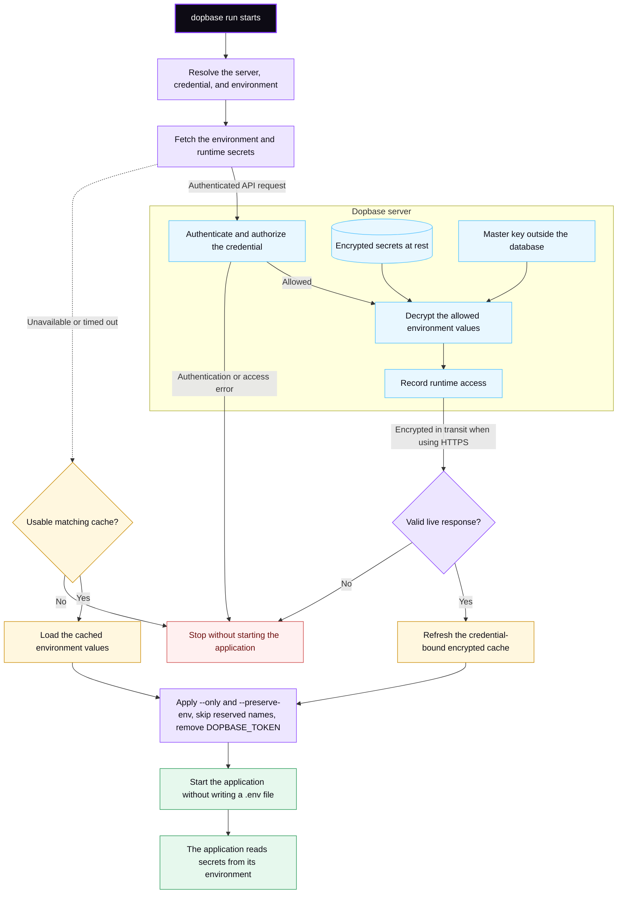

# Run an application

`dopbase run` starts a child process with secrets from one explicit environment.

Use `--` to separate Dopbase arguments from the application command:

```bash
dopbase run payment-service/development -- npm run dev
```

The same pattern works with other commands:

```bash
dopbase run payment-service/development -- cargo run
dopbase run env_482731 -- python app.py
```

The environment may be an immutable `env_...` ID or a readable
`project/environment` reference. An environment already belongs to one project,
so no active project selection is needed.

## Deployment configuration

Application servers should use a runner token. A runner token belongs to one
environment, so `dopbase run` uses that environment and needs no reference:

```bash
export DOPBASE_URL=https://dopbase.example.com
printf '%s' "$RUNNER_TOKEN" | dopbase login --token
dopbase run -- ./payment-service
```

This stores one encrypted credential for the selected server. Saving another
human login or runner token replaces it. CI systems can set `DOPBASE_TOKEN`
instead:

```bash
# The pipeline injects DOPBASE_TOKEN from its secret store.
dopbase run -- ./payment-service
```

Credential priority is `DOPBASE_TOKEN`, then the saved credential. A saved
runner token works for a persistent server; an injected token works for a CI
job without writing local credentials.

You can still name the environment, as in `dopbase run env_482731 -- ./payment-service`.
With a runner token the reference only checks the token. If it names another
environment, `run` stops before the application starts and before the server
reads any value:

```text
Error: This runner token is for payment-service/production, not payment-service/staging. Drop the environment reference, or use a token made for payment-service/staging.
```

`DOPBASE_ENV` works the same way. A runner token ignores the saved default from
`dopbase env default`, which is for people signed in with their own account.

If a deployment command needs a file, use the same runner credential with
`dopbase export env_482731 --output .env`. Export requires a live server and
never uses cached values. See [AWS CodeBuild exports](/cli/commands#export-in-aws-codebuild)
for a pipeline example.

`dopbase run` never opens a login prompt. If no credential is available, it
stops and asks you to run `dopbase login` or set `DOPBASE_TOKEN`. Invalid,
expired, and revoked credentials also stop the command before the application
starts.

With a personal login or personal token, the environment can instead come from
deployment-time configuration:

```bash
export DOPBASE_ENV=env_482731
dopbase run -- ./payment-service
```

An explicit positional environment takes precedence over `DOPBASE_ENV`. If
neither is present, Dopbase uses the server-scoped default saved by:

```bash
dopbase env default payment-service/development
dopbase run -- ./payment-service
```

If no matching default exists, Dopbase stops with instructions for setting
one. Use `dopbase env default --clear` to remove it. An empty `DOPBASE_ENV` is
treated as a configuration error rather than falling back.

Use different environment IDs and runner tokens for production and staging.
See [target projects and environments](/cli/environment-targeting) for a full
two-server example.

## Data flow

Select the diagram to open the viewer. You can zoom, drag the diagram in any
direction, or use the keyboard controls.



The client retrieves the allowed values and injects them into the child process.
It does not create a `.env` file.

Each successful runtime fetch refreshes the latest encrypted cache entry for
that environment. If the server cannot be reached, times out, or returns a 5xx
response, `run` uses the matching cache after waiting up to five seconds for the
complete live fetch. Authentication, authorization, not-found, and invalid
response errors never fall back to cache.

The cache is bound to the normalized server URL and exact session or runner
token that populated it. A logout or token rotation therefore makes the old
cache unavailable. Cache entries do not expire automatically. An offline run
prints the original fetch time and age so operators can judge staleness.

Inspect and maintain the cache without contacting the server:

```bash
dopbase cache list
dopbase cache clean --dry-run
dopbase cache clean --older-than 30d --yes
```

Cleanup targets entries older than 14 days unless `--older-than` or `--all` is
passed. The listing and cleanup preview contain runtime metadata only, never
secret names or values. See [client configuration](/cli/configuration#encrypted-run-cache)
for cache storage and cleanup details.

## Choose which secrets reach the application

By default the child receives every stored secret, and a stored value replaces a
variable of the same name inherited from your shell. Two flags change that.

`--only` limits injection to the keys you name. Repeat the flag or separate keys
with commas:

```bash
dopbase run payment-service/production --only API_KEY,DATABASE_URL -- npm start
dopbase run payment-service/production --only API_KEY --only DATABASE_URL -- npm start
```

If a key named by `--only` is not stored in the environment, Dopbase stops
before the application starts and lists the missing names. Pass
`--allow-missing` to start anyway; the missing names are then printed as a
warning:

```bash
dopbase run payment-service/development --only OPTIONAL_KEY --allow-missing -- npm run dev
```

`--preserve-env` keeps the value your shell already has for the named keys. A
named key your shell does not define still gets the stored secret:

```bash
PORT=3001 dopbase run payment-service/development --preserve-env PORT,LOG_LEVEL -- npm run dev
```

There is no option to preserve every inherited variable. Name each key you want
to keep.

To check which keys arrived without printing their values, list names only:

```bash
dopbase run payment-service/development --only API_KEY -- sh -c 'env | cut -d= -f1'
```

### How `--only` and `--preserve-env` differ

`--only` decides which stored secrets enter the application. `--preserve-env`
decides which value wins when a stored secret and your shell define the same
name.

Take an environment that stores `API_KEY`, `DATABASE_URL`, and `PORT=8080`,
started from a shell that already has `PORT=3001`:

| Command                                      | `API_KEY` | `DATABASE_URL` | `PORT`         |
| -------------------------------------------- | --------- | -------------- | -------------- |
| `dopbase run ENV -- app`                     | stored    | stored         | `8080`, stored |
| `dopbase run ENV --only API_KEY -- app`      | stored    | not set        | `3001`, shell  |
| `dopbase run ENV --preserve-env PORT -- app` | stored    | stored         | `3001`, shell  |

With `--only API_KEY`, the shell's `PORT` survives because `PORT` was never
selected, and `DATABASE_URL` does not reach the application at all. With
`--preserve-env PORT`, every secret is still injected and only `PORT` keeps the
shell's value. If the shell had no `PORT`, the stored `8080` would be used.

|                                     | `--only`                                       | `--preserve-env` |
| ----------------------------------- | ---------------------------------------------- | ---------------- |
| Secrets you did not name            | Left out                                       | Injected         |
| A named key that is not stored      | Stops the run, or warns with `--allow-missing` | Ignored          |
| A named key your shell does not set | Injected                                       | Injected         |
| Names that load code                | Injected when named, with a warning            | Still skipped    |

The flags work together. `--only API_KEY,PORT --preserve-env PORT` injects only
those two keys and keeps the shell's `PORT` if it has one.

### Reserved names

Some stored names are never injected, even when `--only` asks for them. Dopbase
skips them and prints the skipped names, never their values, to standard error.

- Dopbase control variables: `DOPBASE_TOKEN`, `DOPBASE_URL`, `DOPBASE_ENV`,
  `DOPBASE_DATA_DIR`, and `DOPBASE_SECRETS_PATH`. A stored secret cannot hand
  the child a different credential or server.
- Shell variables: `PATH`, `HOME`, `PS1`, `PS2`, and any name that starts with
  `XDG_` or `LC_`. Replacing them could make the child run a different program
  or read a different home directory. Doppler and Infisical skip the same names.

Dopbase also removes `DOPBASE_TOKEN` from the inherited environment, so the
application never receives the credential used to fetch its secrets.

### Names that load code

Some names make a program load extra code or run extra commands when it starts.
A stored secret with one of these names could run code inside your application,
so Dopbase skips them unless you name them in `--only`:

`LD_PRELOAD`, `LD_LIBRARY_PATH`, `DYLD_INSERT_LIBRARIES`, `DYLD_LIBRARY_PATH`,
`NODE_OPTIONS`, `PERL5OPT`, `PYTHONWARNINGS`, `BASH_ENV`, `PROMPT_COMMAND`,
`JAVA_TOOL_OPTIONS`, and `PHPRC`.

If your application needs one, for example `NODE_OPTIONS` to raise the Node.js
memory limit, list it with the other keys the application uses:

```bash
dopbase run payment-service/production --only API_KEY,NODE_OPTIONS -- npm start
```

Dopbase then injects it and prints a warning that names it. Without `--only`,
the warning lists the names it skipped instead.

A few other names change program behavior without loading code: `NODE_VERSION`,
`BROWSER`, `HOSTNAME`, `WINDIR`, and `USERPROFILE`. Dopbase injects them and
prints a warning.

If you did not expect one of these names in the environment, find out who
stored it before you run the application again.

### Order of precedence

For each stored secret, Dopbase checks in this order:

1. With `--only`, keys that were not named are left out.
2. Reserved names are skipped.
3. Names that load code are skipped unless `--only` named them.
4. With `--preserve-env`, a named key your shell already defines keeps the
   shell's value.
5. Anything left replaces the inherited variable of the same name.

Every warning and summary goes to standard error and contains names only, so
the application's standard output stays clean.

## Runtime behavior

Before starting the application, Dopbase writes the resolved project,
environment, immutable ID, injected key count, and `live` or `cache` source to
standard error. When filtering left keys out, the count reads `2 of 7 key(s)`. Cached runs also print the fetch timestamp and age. Values are
never printed.

Dopbase then:

- Stops before launch if live retrieval fails and no usable matching cache is
  available, or when authentication, authorization, environment resolution,
  response validation, or cache authentication fails.
- Forwards operating-system signals to the child process.
- Returns the child's exit status to the calling shell.
- Avoids retaining plaintext values after the child starts where practical.

Applications still need to avoid printing their own environment variables.
Dopbase cannot prevent a child process from logging a value after receiving it.
