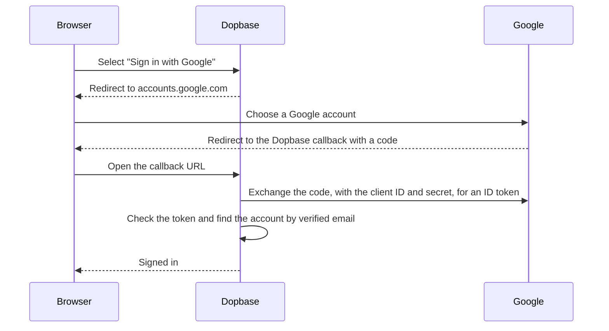

# Sign in with Google

This tutorial connects Dopbase to Google, so people can sign in to the Admin UI
with their Google or Google Workspace account. It takes about ten minutes.
[Single sign-on](./single-sign-on) explains how it works for every provider,
including how accounts are matched and what **Require single sign-on** does.

The examples use `https://dopbase.example.com`. Replace it with your server's
public URL.

## How the pieces fit

Dopbase never sees the Google password. The browser signs in at Google, Google
sends it back to Dopbase with a one-time code, and the Dopbase server trades
that code for an ID token that says who signed in.



The redirect URI you register at Google is the callback URL that Google sends
the browser back to. Dopbase uses the client ID and secret to exchange the
code. The first sign-in finds the Dopbase account by email, so it only works
for people who already have one.

## What you need

- The root account on your Dopbase server.
- An HTTPS public URL for the server. `http://localhost` works for trying it out
  on your own machine. See
  [why the public URL must be HTTPS](./single-sign-on#why-the-public-url-must-be-https).
- A Google account that can create projects in the
  [Google Cloud console](https://console.cloud.google.com). With Google
  Workspace, use an account in your organization so you can limit sign-in to it.
- A Dopbase account for each person who will sign in with Google, with the same
  email as their Google account. Single sign-on never creates accounts, so add
  them on the Users page first.

## 1. Copy the redirect URI from Dopbase

Sign in as root and open **Single sign-on**. Under **1. Register Dopbase with
your provider**, copy the redirect URI:

```text
https://dopbase.example.com/api/v1/auth/sso/callback
```

If the page says single sign-on needs an HTTPS public URL, fix that first.
Dopbase builds the redirect URI from the public URL, so Google needs the final
one.

## 2. Set up Google Auth Platform

1. In the Google Cloud console, pick a project or create one for Dopbase, for
   example `dopbase-sso`.
2. Open **Google Auth Platform**. If the project hasn't used it before, select
   **Get started**.
3. Enter an app name, such as `Dopbase`, and a support email. Google shows both
   on its sign-in screen.
4. Choose the audience:
   - **Internal** if everyone signs in with an account from your Google
     Workspace organization. Google turns away other accounts before they reach
     Dopbase, and the app needs no review.
   - **External** for personal Gmail accounts or people from several
     organizations. Without Google Workspace, this is the only choice.
5. Enter a contact email, accept the user data policy, and select **Create**.

An external app starts in testing. Dopbase asks only for `openid`, `email`, and
`profile`, the basic sign-in scopes, so Google lets any account through without
a test user list. To publish the app, open **Audience** and select **Publish
app**. Google doesn't require a review for apps that ask only for these scopes.

You don't need to add anything under **Data Access**. Dopbase requests the three
scopes each time it starts a sign-in.

## 3. Create the OAuth client

1. In Google Auth Platform, open **Clients** and select **Create client**.
2. Set **Application type** to **Web application** and give it a name, such as
   `Dopbase Admin UI`.
3. Under **Authorized redirect URIs**, select **Add URI** and paste the redirect
   URI from step 1. Leave **Authorized JavaScript origins** empty, because the
   Dopbase server exchanges the sign-in code with Google itself.
4. Select **Create**.
5. Copy the client ID and client secret from the dialog. Keep the secret
   somewhere safe until you've pasted it into Dopbase. If you lose it, add a new
   secret on the client's page and delete the old one.

Google warns that a new redirect URI can take a few minutes to start working,
sometimes longer. If the test sign-in in step 5 fails with
`redirect_uri_mismatch` right after you created the client, wait and try again.

## 4. Enter the details in Dopbase

Back on the **Single sign-on** page, fill in **2. Provider details**:

| Field         | Value                                                                  |
| ------------- | ---------------------------------------------------------------------- |
| Provider      | Google                                                                 |
| Button label  | `Google`, the default. The sign-in page shows **Sign in with Google**. |
| Issuer URL    | `https://accounts.google.com`, with no trailing slash                  |
| Client ID     | The client ID from Google, which ends in `.apps.googleusercontent.com` |
| Client secret | The client secret from Google                                          |

Select **Save**. Dopbase reads Google's discovery document before it saves, so a
mistyped issuer URL fails here and not at sign-in. The client secret is
encrypted with the master key.

## 5. Run a test sign-in

Under **3. Test, then turn on**, select **Test sign-in**. Dopbase sends you to
Google. Choose the Google account you want the root account to use. You land
back on the settings page with "Test sign-in worked. You can turn on single
sign-on now."

The test links root to that Google identity. Root is never matched by email, so
the test sign-in is the only way to link it. Pick an account you'll keep. Root
always keeps its password too, so you can still get in if the Google account
goes away.

## 6. Turn it on

Select **Turn on**. The sign-in page now shows **Sign in with Google** next to
the password form.

To check it, open the sign-in page in a private window, select **Sign in with
Google**, and pick a Google account whose email matches a person's account in
Dopbase, other than root. The first sign-in links that Google identity to the account.
After that, Dopbase recognizes the person by Google's subject identifier, so the
link survives an email change at Google.

## Next steps

Once Google sign-in works, you can:

- turn on **Hide the password form**, so the sign-in page shows only the Google
  button. Root can still open the form at `/login?password`;
- turn on **Require single sign-on** to refuse password sign-in for everyone
  except root, in the browser and in the CLI. This signs everyone except root
  out;
- create accounts without a password on the Users page. Those people sign in
  only with Google;
- tell CLI users that `dopbase login` now opens a browser approval. Nobody types
  a Google password into the terminal.

These options behave the same for every provider. See
[Passwords](./single-sign-on#passwords) and [The CLI](./single-sign-on#the-cli)
for the details.

### Confirming sensitive actions

Revealing or exporting secrets, managing users, and creating personal tokens ask
you to confirm it's you. An account linked to Google confirms in a small Google
window. Google rejects `prompt=login`, so Dopbase sends only `max_age=0` and
checks the sign-in time Google returns. If Google reuses your session without
asking you to sign in again, the confirmation fails. Sign out of Google in that
browser and try again.

## Troubleshooting

### Errors on Google's page

- **Error 400: `redirect_uri_mismatch`.** The URI saved at Google doesn't match
  the one Dopbase sends. Compare the scheme, host, port, and path with the
  redirect URI on the Single sign-on page, and look for a trailing slash. If you
  changed the public URL, update the client at Google too. A URI you just added
  may need a few more minutes.

- **Error 401: `invalid_client`.** Google doesn't know the client ID. Copy it
  again from **Clients** and save. If someone deleted the client, create a new
  one.

- **Access blocked: … can only be used within its organization.** The audience
  is **Internal** and the person picked an account outside your Workspace
  organization. Ask them to choose their work account, or switch the audience to
  **External**.

### Errors on the Dopbase sign-in page

- **No Dopbase account uses that email.** Create the account on the Users page
  with the email the person uses at Google.

- **Your identity provider hasn't verified that email…** This is rare with
  Google. It can happen when a Google account uses a non-Gmail address the
  person never confirmed. They can sign in with their password and link Google
  from the Account page.

- **The root account uses single sign-on only after it's linked…** Run **Test
  sign-in** on the Single sign-on page as root.

- **That identity is already linked to another Dopbase account.** An
  administrator can unlink it from the other account on the Users page.

- **This sign-in expired or was opened in another browser.** A sign-in has to
  finish in the browser that started it. Start again from the sign-in page.

- **Single sign-on didn't work.** A wrong client secret usually ends up here,
  because Google refuses it when Dopbase exchanges the sign-in code. Paste the
  secret again, save, and run **Test sign-in**. The
  [audit log](/reference/audit-events) records each failure as
  `sso_login.failed` with a reason.

## Switching away from Google

If you move to another provider later, saving the new issuer URL removes every
linked Google identity and turns single sign-on off. See
[Switch to another provider](./single-sign-on#switch-to-another-provider) before
you start.
