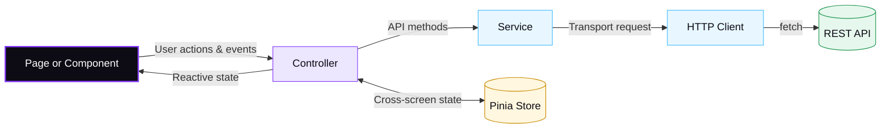

# Frontend architecture

The Admin UI follows a layered design:



Pages render values and events returned by their controller. A page does not
import an API module or a Pinia store directly. A controller owns screen state,
validation, navigation, and feedback messages. A service contains endpoint paths,
request and response types, and transport mapping. The HTTP client is the only
place that calls `fetch`.

## State and logic boundaries

- **Stores**: Use a store only when state is shared across multiple screens.
- **Utilities**: Keep pure parsing, formatting, and validation in `src/utils`.
- **Composables**: Put reactive behavior shared by multiple controllers in `src/composable`.

## Action tracing and errors

When tracing an action, start at the template event, find the controller method
returned to that template, then follow its service call.

Error codes come from `ApiError`. Controllers map stable error codes to field or
operation messages. Never branch on English server messages.

## Asynchronous requests

Read requests should accept an `AbortSignal` when the screen can change while
they are in flight. The owner cancels an older request before starting a newer
one and ignores completions from a different target.

Mutations snapshot their target before awaiting and refresh state only after the
mutation succeeds.

## Pages and controllers

Each screen is two files: one that renders and one that decides. In
`src/pages/Projects`, `Projects.page.vue` holds the template and
`Projects.controller.ts` exports `useProjectsController()`. The controller owns
state, validation, API calls, navigation and messages. The page calls it once
and binds what it returns.

Business rules stay out of templates. If the template needs to know whether the
viewer can delete an environment, the controller exposes a computed such as
`canDelete` and the template reads it. The template never compares levels or
checks capabilities itself.

A page component with its own logic gets the same split, with the controller
next to it: `components/SecretsPanel.vue` and
`components/SecretsPanel.controller.ts`. A component that only renders props and
emits events needs no controller.

Test controllers on their own in `*.controller.test.ts`, using
`src/tests/mount-controller.ts`.

## Where components live

| Folder                        | What goes there                                                                             | Logic                                 |
| ----------------------------- | ------------------------------------------------------------------------------------------- | ------------------------------------- |
| `src/components/ui`           | Low-level `Db*` building blocks: buttons, inputs, tables, menus, dialogs, badges            | None                                  |
| `src/components/app`          | App-aware pieces used on more than one page, such as `ReauthModal` and `OneTimeTokenDialog` | Allowed, through a controller         |
| `src/pages/<Name>/components` | Components that only one page uses                                                          | Allowed, through a sibling controller |

### Keep `ui` components dumb

A component in `src/components/ui` has no business logic. It takes data through
props, reports what the user did through events, and leaves every decision to
its caller. `DbButton` doesn't know which action it triggers. A table renders
the rows and columns it's given without knowing what a secret or a grant is. A
level badge shows the level passed to it and never works out the viewer's
access.

These components don't call APIs, read stores, use the router or check
capabilities. ESLint blocks imports from `~/stores`, `~/services`, `~/pages` and
`~/router` under `src/components/ui/**`. Review catches the rest: domain words
such as project, role or secret in a `ui` component, or a branch on a business
rule, mean the code belongs one layer up.

### Start inside the page

When only one page needs a component, put it in that page's `components/`
folder, even if it looks reusable. Move it once a second page needs it: to
`src/components/app` if it still knows about Dopbase, or to `src/components/ui`
after its domain knowledge moves out into props. A page never imports another
page's components.

## Verification

Run these checks before submitting frontend changes:

```bash
bun run format:repo:check
bun run lint:ui
bun run typecheck:ui
bun run test:ui
bun run build:ui
```
