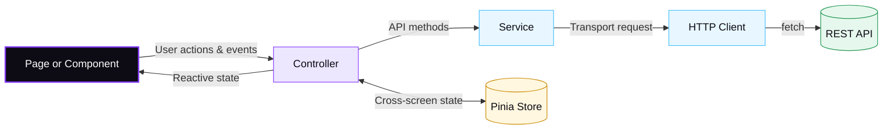

# Frontend architecture

The Admin UI follows a layered design:



Pages render values and events returned by their controller. A page does not
import an API module or a Pinia store directly. A controller owns screen state,
validation, navigation, and feedback messages. A service contains endpoint paths,
request and response types, and transport mapping. The HTTP client is the only
place that calls `fetch`.

## State and logic boundaries

- **Stores**: Use a store only when state is shared across multiple screens.
- **Utilities**: Keep pure parsing, formatting, and validation in `src/utils`.
- **Composables**: Put reactive behavior shared by multiple controllers in `src/composable`.

## Action tracing and errors

When tracing an action, start at the template event, find the controller method
returned to that template, then follow its service call.

Error codes come from `ApiError`. Controllers map stable error codes to field or
operation messages. Never branch on English server messages.

## Asynchronous requests

Read requests should accept an `AbortSignal` when the screen can change while
they are in flight. The owner cancels an older request before starting a newer
one and ignores completions from a different target.

Mutations snapshot their target before awaiting and refresh state only after the
mutation succeeds.

## Pages and controllers

Each screen is two files: one that renders and one that decides. In
`src/pages/Projects`, `Projects.page.vue` holds the template and
`Projects.controller.ts` exports `useProjectsController()`. The controller owns
state, validation, API calls, navigation and messages. The page calls it once
and binds what it returns.

Business rules stay out of templates. If the template needs to know whether the
viewer can delete an environment, the controller exposes a computed such as
`canDelete` and the template reads it. The template never compares levels or
checks capabilities itself.

A page component with its own logic gets the same split, with the controller
next to it: `components/SecretsPanel.vue` and
`components/SecretsPanel.controller.ts`. A component that only renders props and
emits events needs no controller.

Test controllers on their own in `*.controller.test.ts`, using
`src/tests/mount-controller.ts`.

## Where components live

| Folder                        | What goes there                                                                             | Logic                                 |
| ----------------------------- | ------------------------------------------------------------------------------------------- | ------------------------------------- |
| `src/components/ui`           | Low-level `Db*` building blocks: buttons, inputs, tables, menus, dialogs, badges            | None                                  |
| `src/components/app`          | App-aware pieces used on more than one page, such as `ReauthModal` and `OneTimeTokenDialog` | Allowed, through a controller         |
| `src/pages/<Name>/components` | Components that only one page uses                                                          | Allowed, through a sibling controller |

### Keep `ui` components dumb

A component in `src/components/ui` has no business logic. It takes data through
props, reports what the user did through events, and leaves every decision to
its caller. `DbButton` doesn't know which action it triggers. A table renders
the rows and columns it's given without knowing what a secret or a grant is. A
level badge shows the level passed to it and never works out the viewer's
access.

These components don't call APIs, read stores, use the router or check
capabilities. ESLint blocks imports from `~/stores`, `~/services`, `~/pages` and
`~/router` under `src/components/ui/**`. Review catches the rest: domain words
such as project, role or secret in a `ui` component, or a branch on a business
rule, mean the code belongs one layer up.

### Start inside the page

When only one page needs a component, put it in that page's `components/`
folder, even if it looks reusable. Move it once a second page needs it: to
`src/components/app` if it still knows about Dopbase, or to `src/components/ui`
after its domain knowledge moves out into props. A page never imports another
page's components.

## Design source

The console is designed in the Figma file
[Dopbase admin console](https://www.figma.com/design/JkWa51Xg9VDnFvvdvFojmw/-POC--ADMIN-CONSOLE).
Its Foundations page uses the same tokens as `src/style.css`, and its
Components page holds the shared set every screen is built from. Each Figma
component maps to one component in code:

| Figma component                              | Code                                               | Status                    |
| -------------------------------------------- | -------------------------------------------------- | ------------------------- |
| Button                                       | `DbButton`                                         | Exists; restyle to Figma  |
| IconButton                                   | `DbMenu`'s ⋯ trigger, `DbCopyButton` `icon-only`   | Partly built              |
| Badge                                        | `DbBadge`                                          | Exists                    |
| LevelBadge, RoleChip                         | `DbLevelBadge` (with `levelMeter()`), `DbRoleChip` | LevelBadge exists         |
| EnvSwitcher, EnvMenu                         | `ContextBar` in `src/pages/Projects/components`    | Exist                     |
| Kbd                                          | `DbKbd`                                            | Exists                    |
| Input, Select, Checkbox, Switch              | `DbInput`, `DbSelect`, `DbCheckbox`, `DbSwitch`    | Exist; restyle to Figma   |
| SearchField                                  | `DbSearchField`                                    | Exists                    |
| Segment                                      | `DbSegment`                                        | Exists                    |
| RadioCard                                    | `DbRadioCard`                                      | Exists                    |
| Tab, FilterChip                              | `ProjectTabs`; filter chips inside `ActivityPanel` | Built where used          |
| SelectMenu, SelectOption, Combobox           | `DbSelectMenu`, `DbSelectOption`, `DbCombobox`     | To build                  |
| Menu, MenuItem, row ⋯ menu                   | `DbMenu` (⋯ trigger by default), `DbMenuItem`      | Exist                     |
| Toast                                        | `DbToast` and a `useToast` store                   | To build                  |
| Alert                                        | `DbAlert`                                          | Exists; add the warn tone |
| EmptyState                                   | `DbEmptyState`                                     | Exists                    |
| CopyField, CodeSnippet                       | `DbCopyButton`, `DbCode`                           | Exist; restyle to Figma   |
| Table rows on every screen                   | `DbTable`                                          | To build                  |
| Modal, Drawer, mobile Sheet                  | `DbModal`, `DbSheet` (`side="left"` or `"bottom"`) | Exist                     |
| PageHeader, Card, Stat                       | `DbPageHeader`, `DbCard`, `DbStat`                 | To build                  |
| Sidebar, SidebarItem, AccountMenu            | `DashboardNav`, `AccountMenu` in `src/layouts`     | Exist                     |
| ProjectTabs, Context bar                     | `ProjectTabs`, `ContextBar`                        | Exist                     |
| ProjectTreeRow, EnvTreeRow, ProjectAccordion | `ProjectTree` in `src/pages/Projects/components`   | Exist                     |

Sidebar and project pieces know about Dopbase, so they live with their layout or
page rather than in `src/components/ui`.

Every signed-in page puts its content in one column: the `page-width`
utility in `src/style.css` centres it in the area beside the sidebar, 1440px
at most, with the same side padding everywhere. The sidebar stays pinned to
the left edge at every width. Bars that run edge to edge, such as the project context
bar and tabs, keep their border full width and put their contents in the
same column, so headers and tables line up from tab to tab. The "13 Proposals ·
Wide-screen layout" page in Figma compares the alternatives and lists the
research behind this choice: an edge-pinned nav is the easiest mouse target,
and centred content keeps the work where the eyes rest.

Corners stay small. `--radius-card` and Tailwind's own `rounded-lg` and up
are capped at 6px in `src/style.css`, and `--radius-control` is 5px. Use
`rounded-full` only for dots, thin bars and radio buttons, where it never
reads as a rounded box.

## Brand and icons

The logo comes from the Figma brand page. It is two stacked Ds in Lavender
(`--color-brand-mark`, `#c4a3fc`). Where they overlap, the colour is a deeper
tint (`--color-brand-mark-overlap`, `#af8ef0`), never a different hue. In the
console, `DopbaseIcon` draws the mark on its own, without a tile, gradient or
outline.

| File                     | Use                                                                |
| ------------------------ | ------------------------------------------------------------------ |
| `public/logo.svg`        | Lavender mark, for dark backgrounds and the docs site in dark mode |
| `public/logo-violet.svg` | Violet mark, for light backgrounds and the docs site in light mode |
| `public/logo-github.svg` | Mark and wordmark in a violet that reads on both GitHub themes     |
| `public/favicon.svg`     | Violet app icon, also rendered to `favicon.ico`                    |
| `public/og-image.jpg`    | Social preview, from the GitHub social preview banner in Figma     |

Icons live in `src/assets/icons` as one `*.icon.vue` file each, exported from
`index.ts`. They follow the Figma icon set: Lucide shapes on a 24px grid with a
2px stroke in `currentColor`. Add an icon to Figma first, then add the matching
file here. Delete an icon file once nothing imports it.

## Routes

Project pages are addressed by project name and environment name, and each
project tab has its own path:

```text
/projects                              the project tree
/projects/:projectRef                  opens the first environment
/projects/:projectRef/:env/secrets     route "environment"
/projects/:projectRef/:env/tokens      route "environment-tokens"
/projects/:projectRef/:env/activity    route "environment-activity"
/projects/:projectRef/:env/import      route "environment-import"
/projects/:projectRef/access           route "project-access"
/projects/:projectRef/settings         route "project-settings"
/status                                was /instance
```

Every project route renders `Project.page.vue`; `Project.controller.ts` maps
the route name to a tab and decides which tabs the viewer gets. Access and
Settings have no environment in the address, so the controller keeps the one
last opened in the context bar. The selection still lives only in the URL.

Older addresses still work. `/instance`, `/projects/p/:projectRef` and
`/projects/p/:projectRef/access` are plain redirects.
`/projects/p/:projectRef/e/:environmentId` (and its `tokens` and `import`
children) runs `redirectLegacyEnvironment` in `src/router.legacy.ts`, which
looks the id up and moves to the named address, or to the project if the
environment is gone. Because `p` is a fixed segment, a project literally named `p` can't open `/projects/p/access` or `/projects/p/settings`; the legacy redirect wins there.

Machines should keep using the immutable `env_...` id, which survives
renames.

## Capability map

`src/navigation/access-map.ts` says which capabilities open each signed-in
page. A page opens for anyone holding one of them; a page with none listed, or
a route that isn't in the map, opens for every signed-in account. Two things
read it:

- The sidebar. `visibleSections()` keeps the pages the viewer can open and
  drops a section with nothing left in it.
- The router guard. A page the viewer can't open renders the No access screen
  at the address they asked for, so a shared link explains what's missing
  instead of landing on Projects.

To gate a new page, add it to `pages` with its capabilities, and to
`sidebarSections` if it belongs in the nav. Don't add `meta` to the route for
access: the guard ignores it. The server still refuses anything the map lets
through, so the map only decides what the console offers.

## Verification

Run these checks before submitting frontend changes:

```bash
bun run format:repo:check
bun run lint:ui
bun run typecheck:ui
bun run test:ui
bun run build:ui
```
